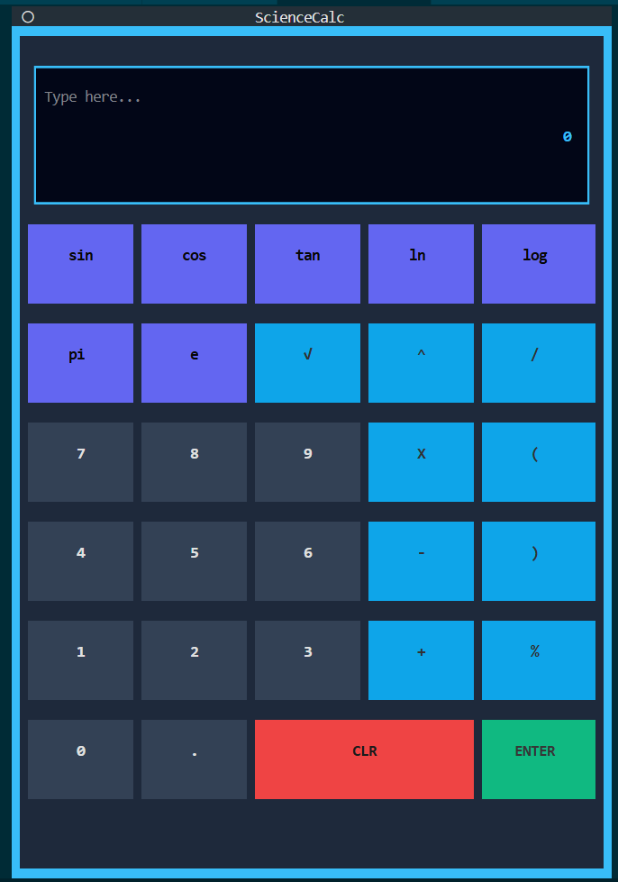

# 🧪 ScienceCalc
###### I am aware that this is really bad! it was made when I was learning python - so...
A sleek, dumb, and fully responsive basic **Scientific Calculator** built with Python and [Textual](https://textual.textualize.io/). Designed for the terminal, featuring a modern glassmorphism-inspired aesthetic and a robust calculation engine.

[](https://pepy.tech/projects/science-calc)\


## ✨ Features

- 📱 **Dynamic-Screen UI**: A responsive layout that adapts to any terminal size.
- 🎨 **Modern Aesthetics**: Sleek dark mode palette (`#0f172a`, `#1e293b`) with vibrant highlights (`#38bdf8`).
- 🔢 **Scientific Functions**:
  - Trigonometry: `sin`, `cos`, `tan`
  - Logarithms: `log` (base 10), `ln` (natural log)
  - Constants: `π` (pi), `e`
  - Algebra: Square root (`√`), Powers (`^`), Percentages (`%`)
- ⌨️ **Keyboard Optimized**:
  - Use **Number-Keys** to type calculations
  - `Enter` to calculate
  - `Ctrl + D` to clear
  - `Ctrl + C` to quit
- 🧠 **Smart(ish) Engine**: Built-in error handling and precision rounding.

## 🚀 Installation

You can install **ScienceCalc** directly from [PyPI](https://pypi.org/project/science-calc/):

### Global (Recommended)
Use UV (Fast, Global):
```bash
uv tool install science-calc
```
### pipx (Standard):
```bash
pipx install science-calc
```
### UVX (If You just wanna test)
```bash
uvx science-calc
```

### Standard Pip (not recomended)
```bash
pip install science-calc
```

## 🎮 How to Run

Once installed, simply type the following in your terminal:
```bash
science-calc
```

## 🛠️ Development Setup

If you want to contribute or run the latest source code:

1. **Clone the repository**:
   ```bash
   git clone https://github.com/Mahir29Flame/Science-Calc.git
   cd Science-Calc
   ```

2. **Install with uv**:
   ```bash
   uv sync
   ```

## 🛠️ Built With

- **[Textual](https://github.com/Textualize/textual)** - The TUI (Terminal User Interface) framework.
- **Python Math** - Powering the calculation engine.

## 📜 License

Distributed under the MIT License. See `LICENSE` for more information.
---
🤝 Contribute & Evolve

We are actively looking to expand this ecosystem with new UI themes, advanced agent features, and hardware integrations. Whether you want to refine this Application.
Feel free to open an Issue, submit a Pull Request, or reach out to discuss new ideas. Let’s build the future of hybrid AI agents together.
---
Created with ❤️ by [Mahir29Flame](https://github.com/Mahir29Flame)
Plz ⭐ this Repo if u liked it :)
repo link- [Science-Calc](https://github.com/Mahir29Flame/Science-Calc) (if you are in PyPI)
